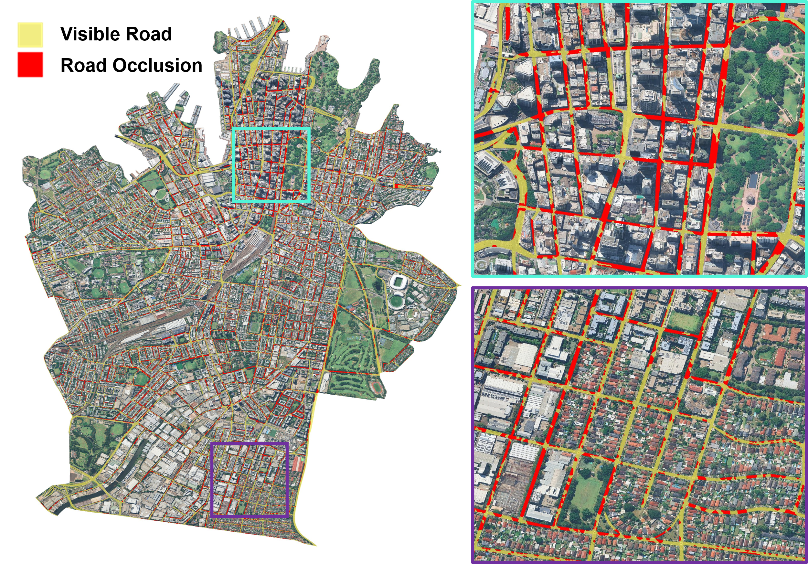
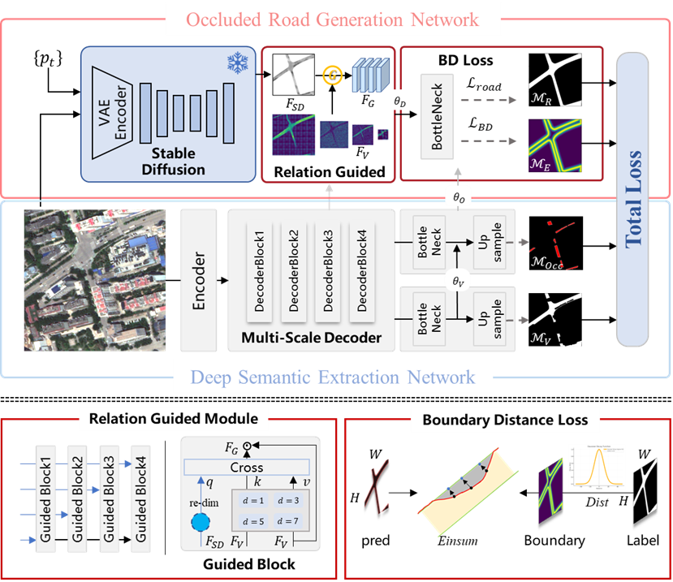

<div align="center">

# OurNet

**Occlusion urban road extraction network**<br>
From global urban high-resolution benchmark dataset to guided generation method

[Setup](#setup) · [Features](#extract-stable-diffusion-features) · [Training](#training) · [Inference](#inference) · [Weights](#pretrained-weights) · [RSIDEA](http://rsidea.whu.edu.cn/)



**Sydney: large-scale road extraction.** Yellow: visible roads · Red: road occlusions.

</div>

OurNet combines semantic road extraction with diffusion-guided completion to recover roads hidden by buildings, trees, and other obstacles.

<p align="center">
  
</p>

## Setup

Python 3.9 and a CUDA-compatible PyTorch installation are recommended.

```bash
git clone https://github.com/WanderRainy/OurNet.git
cd OurNet
python -m venv .venv
source .venv/bin/activate
pip install -r requirements.txt
```

## Extract Stable Diffusion Features

Clone [DIFT](https://github.com/Tsingularity/dift) into `dift/` and install its extraction environment. Place the separately supplied OurNet-specific `dift_sd.py` and `extract_dift_amodal.py` under `dift/`, then replace the upstream implementation:

```bash
git clone https://github.com/Tsingularity/dift.git dift
cp dift/dift_sd.py dift/src/models/dift_sd.py
```

Fill in the model, image, and output paths in `dift/extract_dift_amodal.py`, then run:

```bash
python dift/extract_dift_amodal.py
```

The customized extraction scripts are not bundled here. Use the original extraction settings (`t=181`, `up_ft_index=0`); each 512×512 image requires an aligned `[1280,16,16]` feature tensor saved as `.pt`.

## Data

Create a JSONL manifest with one sample per line; paths are relative to the manifest:

```json
{"image":"images/example.png","label":"labels/example.png","feature":"features/example.pt"}
```

Use RGB images, integer class-ID labels, and aligned diffusion features. Images and labels are resized to 512×512.

- **OurSet-2:** 3 classes — background, visible road, occluded road.
- **OurSet-4:** 5 classes — background, visible road, and three occlusion subtypes, using the dataset's original class IDs.

## Training

```bash
CUDA_VISIBLE_DEVICES=0 python train.py \
  --manifest data/train.jsonl --output outputs/ournet \
  --backbone-weights checkpoints/convnext_base_22k_224.pth \
  --num-classes 3 --epochs 100 --batch-size 8
```

Use `--num-classes 5` for OurSet-4. Training saves the final checkpoint and logs in the output directory. The backbone initialization file is optional; omitting it trains from scratch.

## Pretrained weights

| Dataset | Classes | Download |
| :--- | :---: | :--- |
| OurSet-2 | 3 | [OurNet_OurSet2.pth](https://github.com/WanderRainy/OurNet/releases/download/weights-v1/OurNet_OurSet2.pth) |
| OurSet-4 | 5 | [OurNet_OurSet4.pth](https://github.com/WanderRainy/OurNet/releases/download/weights-v1/OurNet_OurSet4.pth) |

Download the matching weight file into `checkpoints/`.

## Inference

```bash
python infer.py \
  --image data/images/example.png \
  --feature data/features/example.pt \
  --checkpoint checkpoints/OurNet_OurSet2.pth \
  --num-classes 3 --output outputs/example
```

Outputs: `classes.png` (class IDs), `roads.png` (complete-road mask), and `boundary.npy` (boundary response). Use `--device cpu` for CPU inference. Large-image tiling and stitching are handled separately.

## Acknowledgments

Built on [ConvNeXt](https://github.com/facebookresearch/ConvNeXt) and [DIFT](https://github.com/Tsingularity/dift). See [THIRD_PARTY.md](THIRD_PARTY.md) and [LICENSE-ConvNeXt](LICENSE-ConvNeXt).

## © Copyright & Usage

This method is copyrighted by the Intelligent Remote Sensing Data Extraction, Analysis and Application Research Group (RSIDEA)
http://rsidea.whu.edu.cn/
affiliated with the State Key Laboratory of Information Engineering in Surveying, Mapping and Remote Sensing (LIESMARS), Wuhan University.
